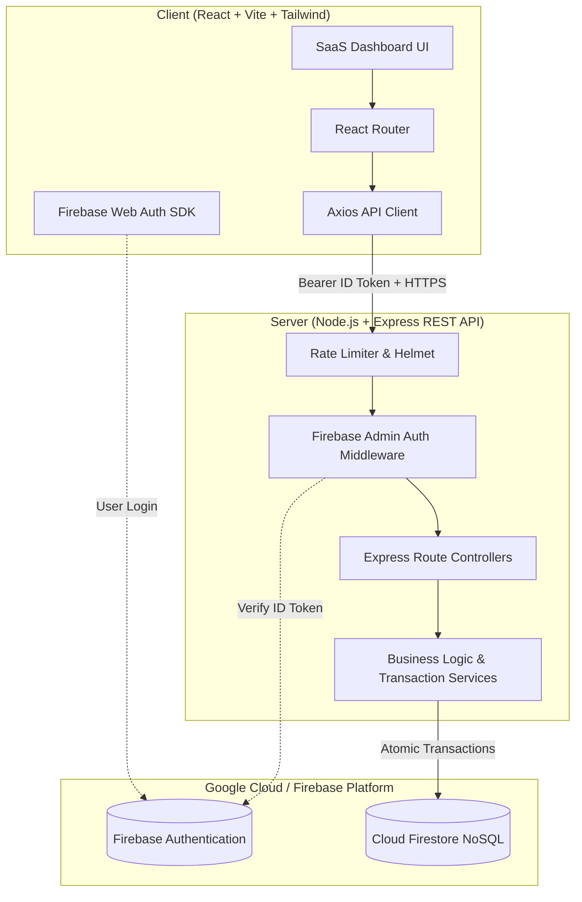

# VendorLens System Architecture

> **Tagline:** *"Understand your business through your data."*  
> **Target Audience:** Small and Medium Enterprises (SMEs), initially tailored for Ghanaian businesses.

---

## 1. High-Level Architectural Overview

VendorLens follows a decoupled **Client-Server Monorepo Architecture** separating presentation concerns from business domain logic and secure data storage.



---

## 2. Core Architectural Principles

### 2.1 Monorepo Separation of Concerns
- **`client/`**: Pure presentation, user interaction, client-side routing, optimistic UI updates, and visual data representations (Chart.js).
- **`server/`**: Single source of truth for all business computations, stock deduction validation, COGS/profit formulas, authorization enforcement, and audit trail creation.
- **Client Trust Zero**: The client never makes direct updates to sensitive Firestore records. All state transitions pass through the Express REST API.

### 2.2 Integer-Pesewa Monetary Precision
In IEEE 754 floating-point arithmetic (used by JavaScript `Number`), decimals produce rounding errors:
```javascript
0.1 + 0.2 === 0.30000000000000004 // True in JS!
```
To eliminate rounding discrepancies across financial accounting, sales receipts, inventory valuation, and tax/profit analysis:
- All financial numbers (`sellingPrice`, `costPrice`, `subtotal`, `total`, `amount`) are stored in Firestore as **integer pesewas** (`1 GHS = 100 pesewas`).
- Example: `GHS 45.50` is stored as `4550`.
- Formatting to decimal strings occurs strictly at display boundaries using standard Ghanaian formatting (`en-GH`, `Africa/Accra`).

### 2.3 Atomic Inventory Transitions
Sales are processed using **Firestore Transactions**:
1. Business ownership and caller authentication are verified.
2. Product inventory levels are retrieved and locked within the transaction.
3. If `requestedQuantity > availableQuantity`, the entire sale is rejected immediately.
4. Total revenue, cost-price snapshots, and subtotal are calculated on the server.
5. The sale record is saved, inventory is atomically decremented, and an immutable `stockMovements` audit record is inserted.
6. All operations either succeed together or rollback completely.

---

## 3. Cloud Firestore Data Schema

```
users/{uid}
  ├── uid: string
  ├── email: string
  ├── businessId: string (reference to owned business)
  ├── role: "owner"
  └── createdAt: timestamp

businesses/{businessId}
  ├── id: string
  ├── ownerUid: string
  ├── name: string ("Accra Central Provisions")
  ├── category: string ("Groceries / Retail")
  ├── description: string
  ├── currency: "GHS"
  ├── location: string ("Makola Market, Accra")
  ├── timezone: "Africa/Accra"
  ├── createdAt: timestamp
  └── updatedAt: timestamp

businesses/{businessId}/products/{productId}
  ├── id: string
  ├── businessId: string
  ├── name: string
  ├── sku: string
  ├── description: string
  ├── category: string
  ├── costPricePesewas: integer
  ├── sellingPricePesewas: integer
  ├── quantity: integer
  ├── lowStockThreshold: integer
  ├── isArchived: boolean (preserves historical references)
  ├── createdAt: timestamp
  └── updatedAt: timestamp

businesses/{businessId}/sales/{saleId}
  ├── id: string
  ├── businessId: string
  ├── items: [
  │     {
  │       productId: string,
  │       productName: string,
  │       quantity: integer,
  │       sellingPricePesewas: integer,
  │       costPricePesewas: integer,
  │       itemTotalPesewas: integer
  │     }
  │   ]
  ├── subtotalPesewas: integer
  ├── totalPesewas: integer
  ├── totalCogsPesewas: integer
  ├── paymentMethod: "cash" | "momo" | "bank" | "other"
  ├── status: "completed" | "voided"
  ├── voidReason: string | null
  ├── voidedAt: timestamp | null
  ├── createdAt: timestamp
  └── createdBy: uid

businesses/{businessId}/expenses/{expenseId}
  ├── id: string
  ├── businessId: string
  ├── description: string
  ├── category: "rent" | "utilities" | "transport" | "salaries" | "marketing" | "packaging" | "maintenance" | "other"
  ├── amountPesewas: integer
  ├── date: string (YYYY-MM-DD)
  ├── notes: string
  ├── createdAt: timestamp
  └── createdBy: uid

businesses/{businessId}/stockMovements/{movementId}
  ├── id: string
  ├── businessId: string
  ├── productId: string
  ├── quantityDelta: integer (+restock, -sale, +voidReversal)
  ├── movementType: "restock" | "sale" | "void_reversal" | "manual_adjustment"
  ├── referenceId: string (saleId or note)
  ├── previousQuantity: integer
  ├── newQuantity: integer
  └── createdAt: timestamp
```

---

## 4. Financial Calculation Definitions

| Metric | Formula | Clarification |
| :--- | :--- | :--- |
| **Gross Revenue** | `Σ(Completed Sale Totals)` | Excludes voided sales. Never call revenue "profit". |
| **Cost of Goods Sold (COGS)** | `Σ(Sold Quantity × Cost-Price Snapshot)` | Historical cost at the exact time of sale. |
| **Gross Profit** | `Revenue - COGS` | Profit generated strictly from product markups. |
| **Operating Expenses** | `Σ(Recorded Expenses)` | Operational running costs (Rent, MoMo charges, salaries). |
| **Estimated Net Operating Profit** | `Gross Profit - Operating Expenses` | True bottom-line earnings of the business. |

---

## 5. Security & Isolation Matrix

1. **Token Verification**: Firebase ID tokens are verified by `server/src/middleware/auth.js` using the Firebase Admin SDK.
2. **Business Ownership Guard**: Downstream controllers extract `req.user.uid` and verify matching `businesses/{businessId}.ownerUid`. Clients can never forge or access another merchant's data.
3. **Environment Security**: Service account private keys are stored only in server environment variables, never sent to the browser or committed to version control.
